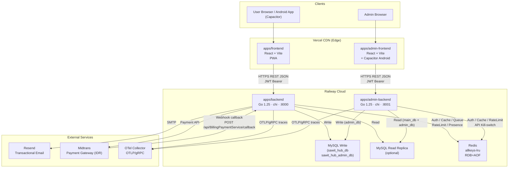
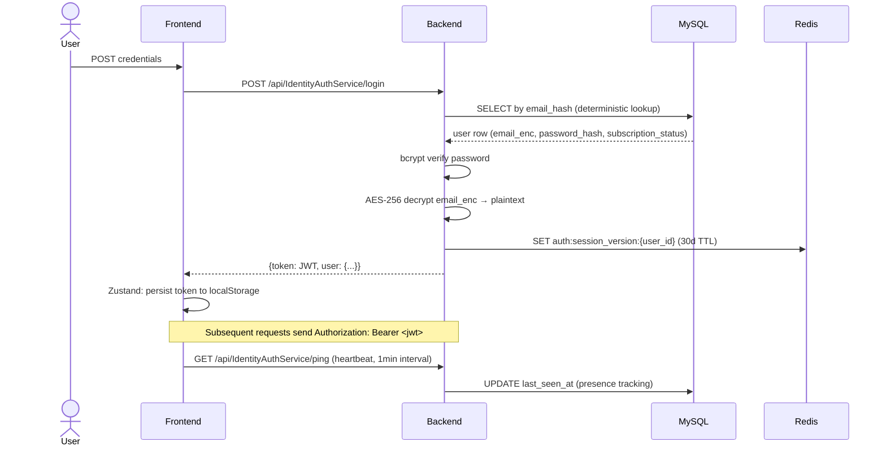
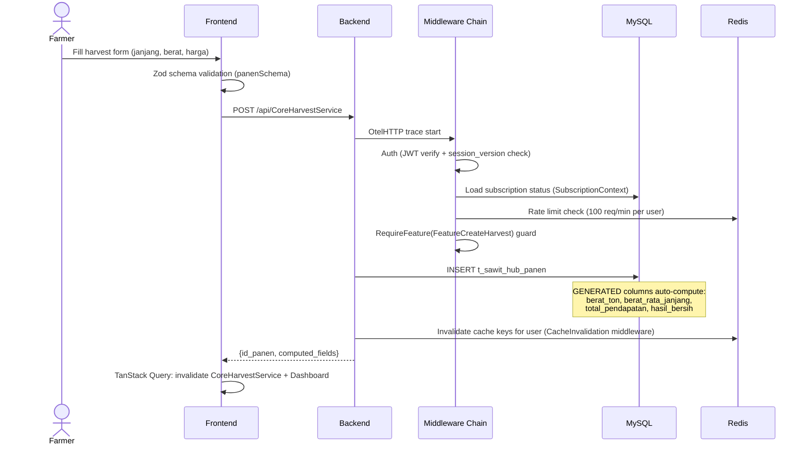
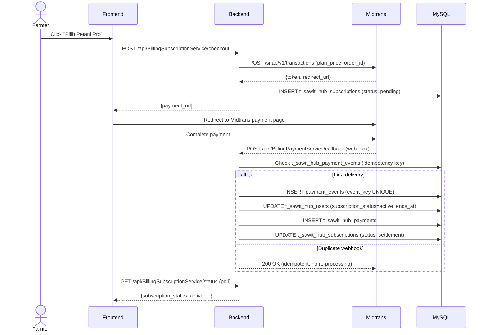
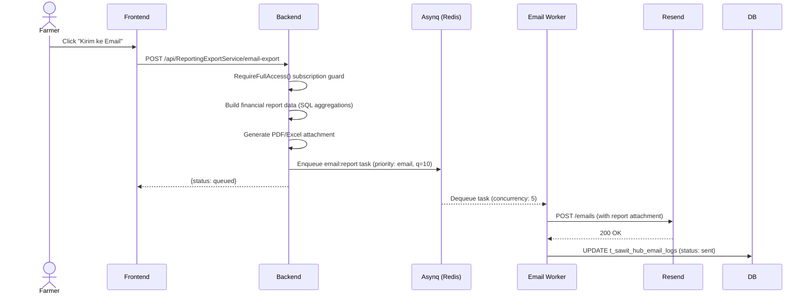
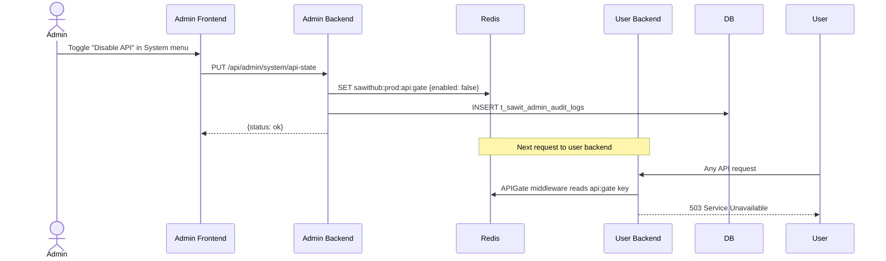
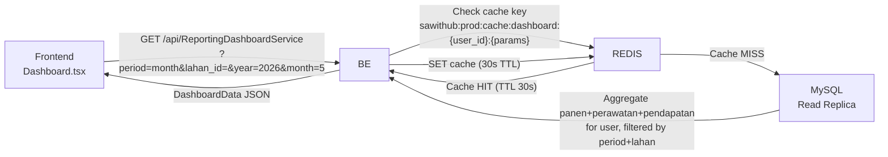
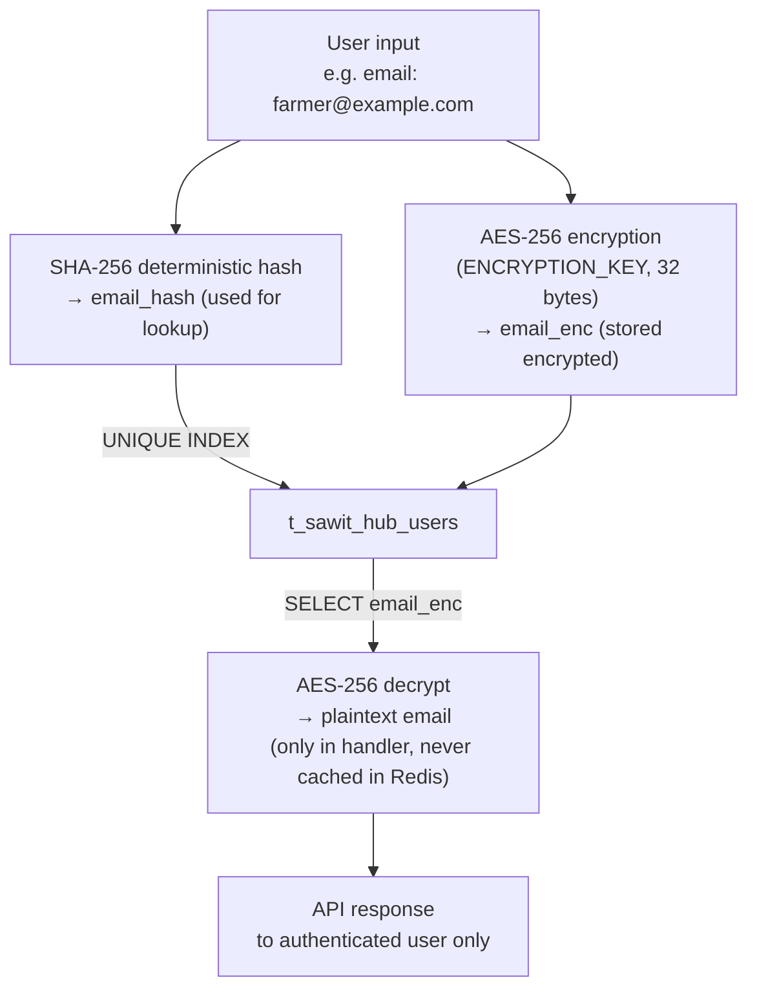
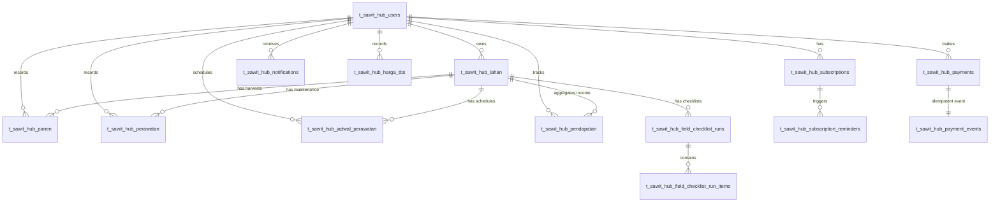

# SawitHub — System Architecture Document

**Version:** 1.0  
**Date:** 2026-05-21  
**Source:** Derived from `docs/discovery/codebase-map.json` + live code review

---

## 1. High-Level Architecture

### 1.1 Architecture Overview

SawitHub is a **monorepo multi-service application** composed of four deployable services and three shared packages. User-facing services are separated from admin services at both the frontend and API layers. Both backends share a MySQL database cluster and a single Redis instance with namespaced keyspaces.



### 1.2 Service Inventory

| Service | Path | Language | Port | Deploy | Purpose |
|---|---|---|---|---|---|
| backend | `apps/backend` | Go 1.25 | 8000 | Railway | User-facing API |
| admin-backend | `apps/admin-backend` | Go 1.25 | auto | Railway | Internal admin API |
| frontend | `apps/frontend` | React + TypeScript | — | Vercel | User SPA + PWA |
| admin-frontend | `apps/admin-frontend` | React + TypeScript | — | Vercel + Capacitor | Admin dashboard + Android |

### 1.3 Shared Packages

| Package | Path | Language | Consumers |
|---|---|---|---|
| `@sawithub/shared` | `packages/shared` | TypeScript (ESM) | frontend, admin-frontend |
| `redis-config` | `packages/redis-config` | Config | backend, admin-backend |
| `database` | `packages/database` | SQL migrations | backend, admin-backend |

---

## 2. Service Architecture

### 2.1 Backend (`apps/backend`)

The primary API server. Handles all user-facing operations.

```
apps/backend/
├── cmd/main.go              ← Entry: init, wire, serve, graceful shutdown
└── internal/
    ├── billing/             ← Subscription state machine
    ├── billingdomain/       ← Billing domain interfaces
    ├── config/              ← Env-based config struct (46 vars)
    ├── crypto/              ← AES-256 encryption helpers
    ├── db/                  ← MySQL connect, migrations, schema sync
    ├── farmcore/            ← Lahan, panen, perawatan, jadwal, checklist
    ├── farmfinance/         ← Income (pendapatan), commodity prices (harga TBS)
    ├── handler/             ← HTTP request handlers (61 functions)
    ├── identity/            ← Auth, profile, session management
    ├── jobs/                ← BillingReminderWorker (ticker-based)
    ├── logger/              ← Structured stdout logger (Docker-compatible)
    ├── mailer/              ← Resend API email client
    ├── middleware/          ← Auth, rate limit, cache invalidation, subscription guards
    ├── notification/        ← Notification delivery
    ├── notificationapp/     ← Notification app layer
    ├── observability/       ← Per-endpoint API metrics (in-memory)
    ├── platform/            ← Theme config, traffic tracking
    ├── queue/               ← Job queue abstractions
    ├── redis/               ← Redis client wrapper
    ├── reporting/           ← Dashboard, financial report, export (email/PDF)
    ├── subscription/        ← Midtrans checkout, webhook handler, subscription state
    ├── taskqueue/           ← Asynq worker (email:welcome, email:reset, email:report)
    ├── telemetry/           ← OpenTelemetry SDK init
    └── validator/           ← Input validation
```

**Startup sequence:**
1. Load env (`.env` → OS vars)
2. Init Redis client
3. Init OTel tracer
4. Connect MySQL write DB (5 retries, 3s delay)
5. Connect MySQL read replica (fallback to write if not configured)
6. Runtime schema sync (`last_seen_at` column detection)
7. Run idempotent migrations
8. Wire handlers, middleware, background jobs
9. Serve on `:{PORT}` with graceful SIGTERM shutdown (30s window)

### 2.2 Admin Backend (`apps/admin-backend`)

Internal-only API for the SawitHub operations team.

**Key differences from `backend`:**
- Separate JWT secret (`ADMIN_JWT_SECRET`)
- Connects to both `sawit_hub_db` (read user data) and `sawit_hub_admin_db` (admin sessions, audit logs)
- Supports 4 DB connection pools: write main, read main, write admin, read admin
- Admin-specific audit log on every mutating action
- API monitor middleware captures per-endpoint response time + error rates

**Admin routes:**
```
POST   /api/admin/auth/login
GET    /api/admin/auth/me
POST   /api/admin/auth/logout
POST   /api/admin/auth/logout-all
GET    /api/admin/overview
GET    /api/admin/users
PUT    /api/admin/users/{id}/role
PUT    /api/admin/users/{id}/status
PUT    /api/admin/users/{id}/deactivate
PUT    /api/admin/users/{id}/password
GET    /api/admin/data
GET    /api/admin/analytics
GET    /api/admin/system
PUT    /api/admin/system/api-state          ← Redis kill-switch toggle
PUT    /api/admin/system/api-endpoint-state ← Per-endpoint kill-switch
GET    /api/admin/settings
PUT    /api/admin/settings
GET    /api/admin/audit
```

### 2.3 Frontend (`apps/frontend`)

React SPA with PWA support deployed to Vercel.

**Tech stack:** React 19, React Router v7, Zustand (auth + farm state), TanStack Query v5, React Hook Form + Zod v4, Recharts, Axios, Vite, Playwright (E2E), Vitest (unit)

**Route groups:**
- Public (16): Landing, About, Login, Signup, ForgotPassword, ResetPassword, Privacy, Terms, Help, Cookie Settings, etc.
- Protected (25): Dashboard, Lahan, Panen, Perawatan, JadwalPerawatan, Pendapatan, Keuangan, LaporanKeuangan, Notifikasi, Profile, Subscription, etc.

**Bundle strategy (Vite):**
- Target: `es2020` (mobile Safari/WebView compatibility)
- Manual chunks: `vendor-react`, `vendor-router`, `vendor-axios` (landing page stays light)
- Heavy deps (recharts, xlsx, jsPDF) stay lazy with their route chunks
- `modulePreload: false` for flaky mobile networks

**PWA (VitePWA):**
- `NetworkFirst` strategy for `/api/*` routes (max 50 entries, 5 min TTL)
- `navigate_fallback_denylist: [/api/.*]` to avoid caching API errors as pages

### 2.4 Admin Frontend (`apps/admin-frontend`)

React admin dashboard with Android delivery via Capacitor.

**Notable additions over user frontend:**
- OpenAPI-generated TypeScript types (`gen:types` from `apps/admin-backend/docs/openapi.yaml`)
- `validate:analytics-events` pre-build hook
- Capacitor Android build target (`capacitor://localhost` origin whitelisted in backend CORS)
- Separate auth store key: `sawit_admin_auth` in localStorage
- Playwright E2E: `admin-login-smoke.spec.ts`

---

## 3. Service Communication Flows

### 3.1 User Authentication Flow



### 3.2 Harvest Record Create Flow



### 3.3 Subscription Checkout + Payment Flow



### 3.4 Financial Report Export Flow



### 3.5 Admin API Kill-Switch Flow



---

## 4. Data Flow Diagrams

### 4.1 Read Path — Dashboard Request



### 4.2 Write Path — PII Field Handling



**PII fields encrypted at rest:** `email_enc`, `phone_enc`, `full_name_enc`  
**PII fields hashed for lookup:** `email_hash`, `phone_hash`  
**Redis forbidden patterns:** `*email*`, `*phone*`, `*password*` (enforced by config)

### 4.3 Redis Keyspace Map

```
sawithub:prod:
├── auth:
│   ├── session_version:{user_id}     TTL 30d   — session invalidation on logout-all
│   ├── token_revocation:{jti}        TTL 30d   — per-token revocation
│   └── login_attempt_window:{ip}     TTL 15m   — brute-force detection
├── ratelimit:
│   ├── user:{user_id}:{route}        TTL 60s   — 100 req/min per user per route
│   └── ip:{ip}:{route}               TTL 60s   — IP-level rate limit
├── cache:
│   ├── dashboard:{user_id}:{params}  TTL 30s   — dashboard aggregate
│   ├── laporan:{user_id}:{params}    TTL 60s   — financial report
│   └── admin_aggregate:{key}         TTL 120s  — admin overview stats
├── queue:                                       — Asynq managed keys
│   ├── pending:{task_type}           TTL 1h
│   ├── retry:{task_type}             TTL 1d
│   └── dead:{task_type}              TTL 7d
├── presence:
│   ├── online:{user_id}              TTL 90s   — online heartbeat (ping endpoint)
│   └── last_seen:{user_id}           TTL 5m    — shadow TTL for last seen
└── api:
    └── gate                                     — Emergency kill-switch flag
```

### 4.4 Database Schema Overview



**Generated columns (computed by MySQL, never stored redundantly):**

| Table | Generated Column | Formula |
|---|---|---|
| `t_sawit_hub_panen` | `berat_ton` | `berat_kg / 1000` |
| `t_sawit_hub_panen` | `berat_rata_janjang` | `berat_kg / jumlah_janjang` |
| `t_sawit_hub_panen` | `total_pendapatan` | `berat_kg * harga_per_kg` |
| `t_sawit_hub_panen` | `hasil_bersih` | `total_pendapatan - biaya_panen` |
| `t_sawit_hub_pendapatan` | `pendapatan_bersih` | `pendapatan_kotor - biaya_total` |

---

## 5. Middleware Chain

Both backends apply middleware in this order. Each layer can short-circuit the request.

```
Incoming HTTP request
        │
        ▼
┌─────────────────────────────┐
│ OtelHTTP                    │  Span creation, trace propagation
├─────────────────────────────┤
│ Logger / SafeRequestLogger  │  Structured request log (stdout)
├─────────────────────────────┤
│ Recoverer                   │  Panic → 500, no crash
├─────────────────────────────┤
│ Timeout (30s)               │  Context deadline
├─────────────────────────────┤
│ SecurityHeaders             │  X-Content-Type-Options, X-Frame-Options,
│                             │  Referrer-Policy, Permissions-Policy
├─────────────────────────────┤
│ CORS                        │  Allowlist: FRONTEND_URL + capacitor://localhost
├─────────────────────────────┤
│ APIObservability / Monitor  │  Per-route latency + error metrics
├─────────────────────────────┤
│ APIGate                     │  Redis kill-switch check (abort if disabled)
├─────────────────────────────┤
│ ── Protected routes only ── │
├─────────────────────────────┤
│ Auth                        │  JWT verify, session_version check, presence update
├─────────────────────────────┤
│ SubscriptionContext         │  Load subscription status into ctx
├─────────────────────────────┤
│ RateLimit                   │  Redis token bucket, 100 burst / 2 per sec refill/user
├─────────────────────────────┤
│ CacheInvalidation           │  POST/PUT/DELETE → flush user cache keys
├─────────────────────────────┤
│ SubscriptionGuard           │  RequireFullAccess() or RequireFeature(f)
├─────────────────────────────┤
│ Handler                     │  Business logic
└─────────────────────────────┘
```

---

## 6. Infrastructure Assumptions

### 6.1 Deployment Topology

| Component | Platform | Notes |
|---|---|---|
| User frontend | Vercel | CDN edge delivery globally, `VITE_API_BASE_URL` points to Railway backend |
| Admin frontend | Vercel | Separate deployment; Android APK via Capacitor build |
| User backend | Railway | Nixpacks build from `apps/backend`; `CGO_ENABLED=0 GOOS=linux` binary |
| Admin backend | Railway | Same build pattern; separate Railway service |
| MySQL (primary) | Railway Managed MySQL | `sawit_hub_db` + `sawit_hub_admin_db` |
| MySQL (read replica) | Railway (optional) | `DATABASE_URL_READ` / `ADMIN_DATABASE_URL_READ`; fallback to primary if not set |
| Redis | Railway Managed Redis | `allkeys-lru` eviction; RDB snapshots + AOF persistence |
| Secrets | Infisical | Synced from Railway env vars via `tools/migrate.py` |
| Traces | OTel Collector | `OTEL_EXPORTER_OTLP_ENDPOINT` (gRPC); stdout fallback if unreachable |

### 6.2 Connection Pool Configuration

```
MySQL (backend):
  MaxOpenConns:     50 (write) / 50 (read)
  MaxIdleConns:     configurable (DBMaxIdleConns)
  ConnMaxLifetime:  configurable (DBConnMaxLifetime)
  ConnMaxIdleTime:  configurable (DBConnMaxIdleTime)

Redis:
  PoolSize:         20 (REDIS_POOL_SIZE default)
  TLS:              true (REDIS_TLS default)
  Eviction:         allkeys-lru
```

### 6.3 Server Timeouts

```
HTTP ReadTimeout:   15s
HTTP WriteTimeout:  30s
HTTP IdleTimeout:   60s
Handler Timeout:    30s (middleware)
DB Ping Timeout:    2s (health check)
DB Connect Retry:   5 attempts × 3s delay
Graceful Shutdown:  30s window
```

### 6.4 Security Posture

| Control | Implementation |
|---|---|
| PII at rest | AES-256 (email, phone, full_name) |
| PII lookup | SHA-256 deterministic hash (email_hash, phone_hash) |
| Passwords | bcrypt |
| Auth tokens | JWT HMAC-SHA256; separate secrets per service |
| Session invalidation | Redis session_version key; increment on logout-all |
| Per-token revocation | Redis token_revocation:{jti} |
| Rate limiting | 100-token bucket per user, refills 2/sec (~120 req/min sustained) |
| Transport | TLS enforced (CORS allowlist, Redis TLS=true) |
| Headers | X-Frame-Options: DENY, nosniff, Permissions-Policy |
| Payment webhooks | Idempotency key in `t_sawit_hub_payment_events` |
| Admin isolation | Separate JWT secret, separate DB, audit log on all mutations |
| Emergency kill-switch | Redis-backed APIGate; per-endpoint control available |

### 6.5 Background Jobs

| Job | Trigger | Queue | Concurrency |
|---|---|---|---|
| `email:welcome` | User registration | `email` (priority 10) | 5 workers total |
| `email:reset_code` | Forgot password | `email` (priority 10) | — |
| `email:report` | Export request | `email` (priority 10) | — |
| `BillingReminderWorker` | Ticker (default 6h) | in-process goroutine | 1 |

BillingReminderWorker sends subscription renewal and trial expiry reminder emails. Enabled via `REMINDER_JOB_ENABLED=true`. Runs in the same process as the backend server; shares DB and mailer dependencies.

---

## 7. Known Architecture Constraints

1. **Single-region deployment** — Railway and Vercel regions should be colocated (e.g., both Singapore) to minimize cross-region latency between frontend edge and backend origin.

2. **Read replica is optional** — Both backends gracefully fall back to the primary DB if `DATABASE_URL_READ` is not set. This means read replicas are not currently required for operation but are supported for scaling.

3. **Asynq task queue shares Redis** — The task queue namespace (`queue:*`) lives in the same Redis instance as auth sessions and rate limiting. A queue backlog spike could exhaust Redis memory under `allkeys-lru`, potentially evicting session keys. Consider a dedicated Redis for queue if task volume grows.

4. **No inter-backend communication** — Backend and admin-backend do not call each other over HTTP. Admin backend reads from the same MySQL database directly. This means admin analytics queries run on the shared DB pool and can affect user-facing latency under heavy admin load if read replicas are not in use.

5. **Capacitor Android uses the same admin-frontend codebase** — There is no separate mobile codebase; the Android APK is a WebView wrapper. Mobile-specific behaviors (offline support, push notifications) would require Capacitor plugins.
