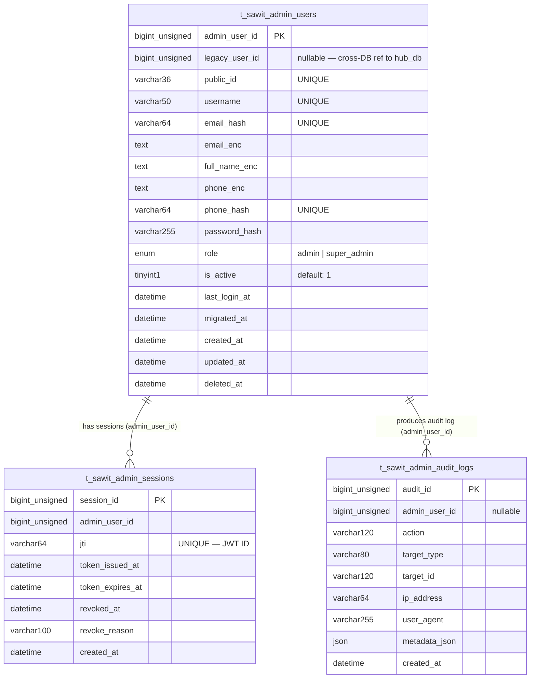

# SawitHub — Entity Relationship Diagram

> Generated from DDL sources in `packages/database/`  
> Engine: MySQL · Charset: utf8mb4 · Collation: utf8mb4_0900_ai_ci / utf8mb4_unicode_ci  
> **Note:** No `FOREIGN KEY ... REFERENCES` constraints are declared in the DDL. All relationships below are *logical* (enforced at the application layer). Cross-database relationships (admin_db → hub_db) cannot be enforced by MySQL at all and are application-managed only.

---

## Database: `sawit_hub_db`

```mermaid
erDiagram

    t_sawit_hub_users {
        bigint_unsigned user_id PK
        varchar36       public_id   "UNIQUE"
        varchar50       username    "UNIQUE"
        varchar64       email_hash  "UNIQUE"
        text            email_enc
        text            full_name_enc
        text            phone_enc
        varchar64       phone_hash
        varchar255      password_hash
        enum            role        "user | admin"
        varchar32       subscription_status "default: trialing"
        datetime        trial_starts_at
        datetime        trial_ends_at       "default: now+14d"
        datetime        subscription_starts_at
        datetime        subscription_ends_at
        varchar64       last_payment_status
        varchar128      midtrans_order_id
        varchar64       plan_name
        decimal12_2     plan_price
        tinyint1        billing_exempt      "default: 0"
        int             active_farm_limit   "default: 1"
        varchar64       current_active_farm_id
        int             trial_farm_create_used
        int             trial_panen_used
        int             trial_perawatan_used
        int             trial_jadwal_used
        int             trial_harvest_used
        int             trial_report_export_used
        datetime        created_at
        datetime        updated_at
        datetime        last_seen_at
        datetime        deleted_at
    }

    t_sawit_hub_lahan {
        bigint_unsigned id_lahan  PK
        bigint_unsigned user_id
        varchar100      nama_kebun
        varchar50       jenis_bibit
        varchar255      lokasi
        decimal10_2     luas_ha
        int             jumlah_pohon
        year            tahun_tanam
        datetime        created_at
        datetime        updated_at
        datetime        deleted_at
    }

    t_sawit_hub_panen {
        bigint_unsigned id_panen       PK
        bigint_unsigned user_id
        bigint_unsigned id_lahan
        date            tanggal_panen
        decimal10_2     luas_panen_ha
        int             jumlah_janjang
        decimal12_2     berat_kg
        decimal12_4     berat_ton           "GENERATED: berat_kg/1000"
        decimal10_3     berat_rata_janjang  "GENERATED: berat_kg/jumlah_janjang"
        decimal10_2     harga_per_kg
        decimal14_2     total_pendapatan    "GENERATED: berat_kg*harga_per_kg"
        decimal12_2     biaya_panen
        decimal14_2     hasil_bersih        "GENERATED: total_pendapatan-biaya_panen"
        text            catatan
        datetime        created_at
        datetime        updated_at
        datetime        deleted_at
    }

    t_sawit_hub_perawatan {
        bigint_unsigned id_perawatan      PK
        bigint_unsigned user_id
        bigint_unsigned id_lahan
        date            tanggal_perawatan
        varchar50       jenis_perawatan
        varchar150      bahan
        decimal10_2     jumlah
        enum            satuan            "kg|liter|gram|unit|zak|botol"
        decimal12_2     harga_satuan
        decimal12_2     total_harga_material
        decimal12_2     biaya_pekerja
        decimal12_2     total_biaya_perawatan
        text            keterangan
        datetime        created_at
        datetime        updated_at
        datetime        deleted_at
    }

    t_sawit_hub_pendapatan {
        bigint_unsigned id_pendapatan  PK
        bigint_unsigned user_id
        bigint_unsigned id_lahan
        date            tanggal_panen
        int             total_janjang
        decimal12_2     total_berat_kg
        decimal14_2     pendapatan_kotor
        decimal14_2     biaya_total
        decimal14_2     pendapatan_bersih  "GENERATED: kotor-biaya_total"
        text            catatan
        datetime        created_at
        datetime        updated_at
        datetime        deleted_at
    }

    t_sawit_hub_jadwal_perawatan {
        bigint_unsigned id_jadwal_perawatan  PK
        bigint_unsigned user_id
        bigint_unsigned id_lahan
        varchar50       jenis_perawatan
        text            deskripsi
        enum            frequensi_tipe       "mingguan|dua_mingguan|bulanan|...custom"
        int             frequensi_custom_hari
        date            tanggal_mulai
        date            tanggal_akhir
        decimal12_2     estimasi_biaya
        tinyint1        is_active            "default: 1"
        text            catatan
        datetime        created_at
        datetime        updated_at
        datetime        deleted_at
    }

    t_sawit_hub_field_checklist_runs {
        bigint_unsigned id_run      PK
        bigint_unsigned user_id
        bigint_unsigned id_lahan
        varchar255      title
        varchar32       status      "default: pending"
        date            task_date
        datetime        completed_at
        datetime        created_at
        datetime        updated_at
        datetime        deleted_at
    }

    t_sawit_hub_field_checklist_run_items {
        bigint_unsigned id_item     PK
        bigint_unsigned id_run
        varchar255      item_label
        int             item_order  "default: 0"
        tinyint1        is_required "default: 1"
        varchar32       status      "default: pending"
        text            note
        datetime        created_at
        datetime        updated_at
    }

    t_sawit_hub_subscriptions {
        bigint_unsigned id          PK
        bigint_unsigned user_id
        varchar32       provider    "default: midtrans"
        varchar128      order_id    "UNIQUE"
        varchar32       status      "default: pending_payment"
        varchar64       plan_name
        decimal12_2     plan_price
        varchar8        currency    "default: IDR"
        datetime        starts_at
        datetime        ends_at
        datetime        created_at
        datetime        updated_at
        datetime        deleted_at
    }

    t_sawit_hub_payments {
        bigint_unsigned id              PK
        bigint_unsigned user_id
        varchar32       provider        "default: midtrans"
        varchar128      order_id        "UNIQUE"
        varchar128      transaction_id
        varchar32       payment_status  "default: pending"
        decimal12_2     gross_amount    "default: 0.00"
        varchar8        currency        "default: IDR"
        varchar64       payment_type
        datetime        paid_at
        datetime        created_at
        datetime        updated_at
        datetime        deleted_at
    }

    t_sawit_hub_payment_events {
        bigint_unsigned id         PK
        varchar32       provider
        varchar191      event_key  "UNIQUE with provider"
        varchar128      order_id
        varchar64       status
        json            payload
        datetime        created_at
    }

    t_sawit_hub_subscription_reminders {
        bigint_unsigned id               PK
        bigint_unsigned user_id
        bigint_unsigned subscription_id  "nullable"
        varchar32       reminder_type
        datetime        scheduled_for
        datetime        sent_at
        varchar32       status           "default: pending"
        datetime        created_at
    }

    t_sawit_hub_notifications {
        bigint_unsigned id          PK
        bigint_unsigned user_id
        varchar64       type
        varchar255      title
        text            message
        varchar255      action_url
        tinyint1        is_read     "default: 0"
        datetime        read_at
        datetime        created_at
        datetime        deleted_at
    }

    t_sawit_hub_email_logs {
        bigint_unsigned id            PK
        bigint_unsigned user_id       "nullable"
        varchar191      event_key     "UNIQUE"
        varchar191      email
        varchar64       type
        varchar255      subject
        varchar32       status        "default: pending"
        varchar32       provider
        text            error_message
        datetime        sent_at
        datetime        created_at
    }

    t_sawit_hub_harga_tbs {
        bigint_unsigned id_harga     PK
        bigint_unsigned user_id
        date            tanggal
        decimal10_2     harga_per_kg
        varchar100      sumber
        text            catatan
        datetime        created_at
    }

    t_sawit_hub_password_resets {
        varchar36  id          PK  "UUID string"
        varchar64  email_hash
        varchar6   code
        datetime   expires_at
        datetime   used_at
        datetime   created_at
    }

    t_sawit_hub_visits {
        varchar36  id          PK  "UUID string"
        varchar64  session_id
        varchar64  visitor_id
        varchar45  ip_address
        varchar10  device_type
        varchar100 country
        varchar100 city
        varchar255 page
        timestamp  created_at
    }

    t_sawit_hub_theme_configs {
        bigint_unsigned id               PK
        varchar7        primary_color    "default: #16a34a"
        varchar7        secondary_color  "default: #059669"
        varchar7        accent_color     "default: #f97316"
        varchar7        background_color "default: #ffffff"
        varchar7        text_color       "default: #111827"
        varchar7        border_color     "default: #e5e7eb"
        tinyint1        dark_mode        "default: 0"
        varchar20       theme_mode       "default: light"
        datetime        created_at
        datetime        updated_at
    }

    %% ── Core ownership ──────────────────────────────────────────
    t_sawit_hub_users ||--o{ t_sawit_hub_lahan                    : "owns (user_id)"
    t_sawit_hub_users ||--o{ t_sawit_hub_harga_tbs                : "records (user_id)"
    t_sawit_hub_users ||--o{ t_sawit_hub_notifications            : "receives (user_id)"
    t_sawit_hub_users ||--o{ t_sawit_hub_email_logs               : "sent to (user_id)"

    %% ── Farm operations ─────────────────────────────────────────
    t_sawit_hub_lahan ||--o{ t_sawit_hub_panen                    : "harvested on (id_lahan)"
    t_sawit_hub_users ||--o{ t_sawit_hub_panen                    : "records (user_id)"

    t_sawit_hub_lahan ||--o{ t_sawit_hub_perawatan                : "maintained on (id_lahan)"
    t_sawit_hub_users ||--o{ t_sawit_hub_perawatan                : "records (user_id)"

    t_sawit_hub_lahan ||--o{ t_sawit_hub_pendapatan               : "earns on (id_lahan)"
    t_sawit_hub_users ||--o{ t_sawit_hub_pendapatan               : "records (user_id)"

    t_sawit_hub_lahan ||--o{ t_sawit_hub_jadwal_perawatan         : "scheduled on (id_lahan)"
    t_sawit_hub_users ||--o{ t_sawit_hub_jadwal_perawatan         : "created by (user_id)"

    t_sawit_hub_lahan ||--o{ t_sawit_hub_field_checklist_runs     : "inspected at (id_lahan)"
    t_sawit_hub_users ||--o{ t_sawit_hub_field_checklist_runs     : "owns (user_id)"

    %% ── Checklist detail ─────────────────────────────────────────
    t_sawit_hub_field_checklist_runs ||--o{ t_sawit_hub_field_checklist_run_items : "contains (id_run)"

    %% ── Billing ─────────────────────────────────────────────────
    t_sawit_hub_users        ||--o{ t_sawit_hub_subscriptions         : "has (user_id)"
    t_sawit_hub_users        ||--o{ t_sawit_hub_payments              : "pays (user_id)"
    t_sawit_hub_subscriptions ||--o{ t_sawit_hub_subscription_reminders : "triggers (subscription_id)"
    t_sawit_hub_users        ||--o{ t_sawit_hub_subscription_reminders : "notified (user_id)"
    t_sawit_hub_payments     ||--o{ t_sawit_hub_payment_events        : "logs webhook (order_id)"
```

---

## Database: `sawit_hub_admin_db`

---

## Cross-Database Relationships

| Source | Column | Target | Type | Note |
|--------|--------|--------|------|------|
| `sawit_hub_admin_db`.`t_sawit_admin_users` | `legacy_user_id` | `sawit_hub_db`.`t_sawit_hub_users`.`user_id` | Soft reference | No FK constraint possible across databases. Used during migration of legacy admin users; NULL for new accounts created directly in admin_db. |
| `sawit_hub_db`.`t_sawit_hub_payment_events` | `order_id` | `sawit_hub_db`.`t_sawit_hub_payments`.`order_id` | Logical join key | Idempotency table; payment events are linked to a payment record by order_id, but no FK declared to support independent webhook arrival before payment row creation. |
| `sawit_hub_db`.`t_sawit_hub_payment_events` | `order_id` | `sawit_hub_db`.`t_sawit_hub_subscriptions`.`order_id` | Logical join key | Same order_id space as subscriptions. |
| `sawit_hub_db`.`t_sawit_hub_users` | `midtrans_order_id` | `sawit_hub_db`.`t_sawit_hub_subscriptions`.`order_id` | Denormalized cache | Redundant storage of latest order_id on the user row for fast subscription status checks without a JOIN. |
