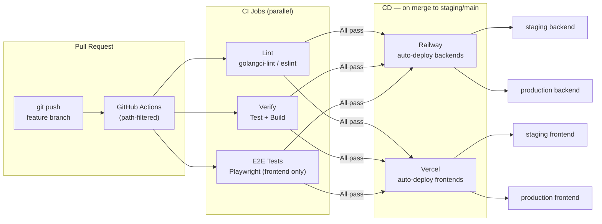

# SawitHub — Software Development Lifecycle (SDLC) Document

**Version:** 1.0  
**Date:** 2026-05-21  
**Scope:** All four services in the `sawithub-app` monorepo

---

## 1. Development Workflow

### 1.1 Principles

- **Monorepo, polyglot:** Go (backends) and TypeScript (frontends) live in the same repo under `apps/`. Changes to shared packages trigger CI for their consumers.
- **Path-filtered CI:** GitHub Actions workflows only run when files relevant to a given service change. A commit that only touches `apps/frontend` does not trigger backend CI.
- **Two deployment targets:** `main` branch maps to production; `staging` branch maps to staging. Pull requests target one of these two branches.
- **Trunk-based development recommended:** Short-lived feature branches merged to `staging` frequently, then `staging` promoted to `main` for production releases.

### 1.2 Local Development Setup

```bash
# 1. Install Node.js workspace dependencies
make install                # npm install at root

# 2. Start individual services
make dev-backend            # Go run apps/backend/cmd/main.go (:8000)
make dev-admin-backend      # Go run apps/admin-backend/cmd/main.go
make dev-frontend           # Vite dev server for apps/frontend (:5173)
make dev-admin-frontend     # Vite dev server for apps/admin-frontend

# 3. Run all tests
make test-go                # go test ./... for both backends
npm run test --workspace=@sawithub/frontend  -- --run

# 4. Lint + vet
make vet-go
make lint-go  # (golangci-lint must be installed locally)

# 5. Tidy Go modules
make tidy-go
```

**Frontend dev proxy:** Vite proxies `/api` → `http://localhost:8000` in dev mode, so the frontend runs without CORS issues against the local backend.

**Admin frontend OpenAPI types:** Run `npm run gen:types --workspace=@sawithub/admin-frontend` after changing `apps/admin-backend/docs/openapi.yaml` to regenerate `src/api/types.generated.ts`.

### 1.3 Environment Variables

Each service reads from a `.env` file at its package root during local development. Never commit `.env` files. Production and staging secrets are managed in Infisical and injected by Railway at deploy time.

| Service | Local env file |
|---|---|
| `apps/backend` | `apps/backend/.env` |
| `apps/admin-backend` | `apps/admin-backend/.env` |
| `apps/frontend` | `apps/frontend/.env.local` |
| `apps/admin-frontend` | `apps/admin-frontend/.env.local` |

Required minimum for local backend dev:
```bash
DATABASE_URL=mysql://...
REDIS_ADDR=localhost:6379
JWT_SECRET=local-dev-secret-32-chars-min
ENCRYPTION_KEY=local-dev-aes-key-32-bytes!!!
FRONTEND_URL=http://localhost:5173
```

---

## 2. Branching Strategy

### 2.1 Branch Model

```
main ──────────────────────────────────────── Production
  │                                             ↑ merge
staging ──────────────────────────────────── Staging
  │         ↑ merge via PR                     ↑ merge via PR
  ├── feature/SAW-123-harvest-bulk-import
  ├── feature/SAW-145-koperasi-tier
  ├── fix/SAW-167-panen-duplicate-unique
  └── chore/upgrade-go-1-26
```

### 2.2 Branch Naming Convention

| Prefix | Use |
|---|---|
| `feature/<ticket>-<slug>` | New functionality |
| `fix/<ticket>-<slug>` | Bug fixes |
| `chore/<slug>` | Dependency bumps, tooling, refactors |
| `hotfix/<ticket>-<slug>` | Production-only critical patch (targets `main` directly, then back-merged to `staging`) |
| `docs/<slug>` | Documentation only |

### 2.3 Branch Rules (recommended)

- `main` and `staging` are protected; direct pushes are blocked.
- PRs to `main` require: passing CI + at least 1 reviewer approval.
- PRs to `staging` require: passing CI only (faster iteration).
- `staging` → `main` promotion is a PR (no squash; preserve commit history for `git blame`).
- Hotfixes merge to `main` first, then cherry-picked to `staging` to avoid a full re-test cycle.

### 2.4 Commit Message Convention

Follow Conventional Commits:

```
<type>(<scope>): <short summary>

[optional body]

[optional footer: closes #issue]
```

**Types:** `feat`, `fix`, `chore`, `refactor`, `test`, `docs`, `perf`, `ci`  
**Scopes:** `backend`, `admin-backend`, `frontend`, `admin-frontend`, `shared`, `db`, `ci`

Examples:
```
feat(backend): add bulk harvest import endpoint
fix(frontend): correct IDR formatting on Safari iOS
chore(deps): upgrade go-chi to v5.3.0
perf(backend): add composite index on user_id+tanggal_panen
```

---

## 3. CI/CD Pipeline

### 3.1 Pipeline Overview



### 3.2 CI Workflows (existing — `.github/workflows/`)

#### `backend.yml` — User Backend

**Triggers:** PR or push to `main`/`staging` touching `apps/backend/**`, `go.work`, `go.work.sum`

| Job | Steps | Timeout |
|---|---|---|
| `lint` | `golangci-lint v1.64.8` | 10 min |
| `verify` | `go test ./...` + `go build -o /dev/null ./cmd/...` | 10 min |

Jobs run in parallel (lint and verify are independent).

#### `admin-backend.yml` — Admin Backend

**Triggers:** PR or push to `main`/`staging` touching `apps/admin-backend/**`, `go.work`, `go.work.sum`

| Job | Steps | Timeout |
|---|---|---|
| `lint` | `golangci-lint v1.64.8` | 10 min |
| `verify` | `go test ./...` + `go build -o /dev/null ./...` | 10 min |

#### `frontend.yml` — User Frontend

**Triggers:** PR or push to `main`/`staging` touching `apps/frontend/**`, `packages/shared/**`, root `package.json`/`package-lock.json`

| Job | Steps | Timeout |
|---|---|---|
| `check` | `npm audit` (high severity) + `eslint` + `tsc -b` + `vitest --run` | 10 min |
| `build` | `npm run build` (Vite production build) | 10 min |
| `e2e` | Playwright Chromium (browser binary cached by hash) → `npm run test:e2e` | 15 min |

`check` and `build` run in parallel. `e2e` depends only on a successful build (implicitly, via build job).  
E2E artifacts (screenshots, traces) are uploaded on failure for debugging.

**Important:** `VITE_ALLOW_MOCK_BILLING=true` is set in the E2E job to enable the mock payment provider so payment flows can be tested without real Midtrans credentials.

#### `admin-frontend.yml` — Admin Frontend

**Triggers:** PR or push to `main`/`staging` touching `apps/admin-frontend/**`

| Job | Steps | Timeout |
|---|---|---|
| `check` | lint + typecheck + unit tests | 10 min |
| `build` | `npm run build` | 10 min |
| `e2e` | Playwright: `admin-login-smoke.spec.ts` | 15 min |

### 3.3 Concurrency Strategy

All four workflows use:
```yaml
concurrency:
  group: ${{ github.workflow }}-${{ github.ref }}
  cancel-in-progress: true
```

This cancels any in-progress CI run for the same branch when a new push arrives, preventing queue pile-ups on fast-moving feature branches.

### 3.4 Deployment Pipeline

#### Backend (Railway)

Railway watches the connected GitHub repository. On merge to the target branch:
1. Railway detects the push via webhook
2. Nixpacks build: `CGO_ENABLED=0 GOOS=linux go build -o dist/sawit-api ./cmd/main.go`
3. Container image pushed to Railway registry
4. Rolling deploy (new container starts, health check passes, old container drained)
5. Startup sequence runs migrations automatically (`db.RunMigrations` on boot)

**No manual migration step is required** — migrations are idempotent and run on every startup via `golang-migrate`.

#### Frontend (Vercel)

Vercel watches the GitHub repository with framework preset: Vite.
1. `npm ci` + `npm run build --workspace=@sawithub/frontend`
2. Output `dist/` deployed to Vercel CDN edge
3. Preview URL generated per PR (for manual visual review)
4. Production domain updated on merge to `main`

#### Secrets Management

Railway injects secrets as environment variables at build/runtime.  
`tools/migrate.py` syncs Railway env vars to Infisical when secrets rotate.

### 3.5 Recommended CI Improvements

| Improvement | Rationale |
|---|---|
| Add `go vet` step to backend CI | Currently only `golangci-lint` runs; `go vet` catches a complementary set of issues |
| Database integration tests (backend) | Current `go test ./...` runs unit tests only; add a test-only MySQL container via `services:` in the GHA job for handler-level integration tests |
| OpenAPI diff check | Fail CI if `admin-backend/docs/openapi.yaml` changes without regenerating `src/api/types.generated.ts` |
| Dependency review action | Add `actions/dependency-review-action` to catch newly introduced vulnerable deps on PRs |
| Staging smoke test | After Railway deploys staging, run a lightweight `curl /health` check against the staging URL to confirm the new binary started |

---

## 4. Testing Strategy

### 4.1 Testing Pyramid

```
                    ┌──────────┐
                    │   E2E    │  Playwright — critical user paths
                    │  Tests   │  (2 specs: frontend + admin smoke)
                   /└──────────┘\
                  /              \
            ┌──────────────────────┐
            │   Integration Tests  │  (recommended addition — not yet present)
            │  handler-level, real │
            │  MySQL + Redis       │
           /└──────────────────────┘\
          /                          \
    ┌──────────────────────────────────┐
    │          Unit Tests              │
    │  Go: go test ./...               │
    │  TS: Vitest                      │
    └──────────────────────────────────┘
```

### 4.2 Backend Testing (`apps/backend`, `apps/admin-backend`)

**Framework:** Go standard `testing` package  
**Runner:** `go test ./...`  
**Coverage target:** (not currently enforced — recommend 60% minimum for `internal/` packages)

**What to unit test:**
- `internal/crypto`: AES encrypt/decrypt round-trips
- `internal/billing`: subscription state machine transitions
- `internal/subscription`: payment status → subscription status mapping
- `internal/middleware`: JWT parsing, rate limit logic
- `internal/validator`: input validation edge cases
- `internal/reporting`: financial calculation correctness

**Integration test pattern (recommended):**

```go
// Use testcontainers-go to spin up MySQL+Redis for handler tests
func TestCreatePanen_Integration(t *testing.T) {
    db := testutil.NewTestDB(t)     // ephemeral MySQL
    redis := testutil.NewTestRedis(t)
    h := handler.New(db, db, cfg, true, redis)
    // POST to handler, assert DB state
}
```

**Mock vs. real infrastructure:** Prefer real test databases for handler tests. The production incident pattern (mocked tests pass, real DB fails on migration) makes mock-only testing inadequate for data-layer code.

### 4.3 Frontend Testing (`apps/frontend`)

**Unit test framework:** Vitest  
**E2E framework:** Playwright (Chromium only in CI, full browser matrix optional locally)

**Unit tests (Vitest):**
- `src/stores/authStore.test.ts` — auth state transitions
- `src/utils/rupiah.test.ts` — IDR number formatting

**Expand unit test coverage to:**
- `src/utils/analytics.ts` — event dispatch correctness
- `src/schemas/` — Zod schema validation edge cases
- `src/hooks/` — custom hook behavior with mocked TanStack Query
- `src/utils/apiError.ts` — error classification

**E2E tests (Playwright):**

| File | Coverage |
|---|---|
| *(existing, path not shown)* | Billing/payment flow with mock provider (`VITE_ALLOW_MOCK_BILLING=true`) |

**Recommended additional E2E specs:**

```
tests/
├── auth.spec.ts         — signup → login → logout
├── harvest.spec.ts      — create lahan → create panen → verify dashboard
├── subscription.spec.ts — trial → checkout (mock) → active state
├── report.spec.ts       — request email export → success toast
└── admin-login.spec.ts  — (existing smoke test)
```

**Playwright configuration highlights:**
- Browser binaries cached by `hashFiles('apps/frontend/package-lock.json')` — only reinstalled on Playwright version change
- `test-results/` uploaded as artifact on failure for screenshot/trace inspection

### 4.4 Shared Package Testing (`packages/shared`)

`@sawithub/shared` exports TypeScript types and Zod schemas. Tests should cover:
- All Zod schemas: valid inputs pass, invalid inputs produce expected error messages
- Edge cases: `luas_ha = 0` should fail `lahanSchema`, `tahun_tanam` boundary years

Add `vitest` as a dev dependency in `packages/shared` and run via workspace test command.

### 4.5 Testing Environment Variables

| Context | Key vars |
|---|---|
| Backend unit tests | `DATABASE_URL` pointing to test DB (or testcontainers) |
| Frontend unit tests | No external deps; mock Axios with `vi.mock` |
| Frontend E2E | `VITE_ALLOW_MOCK_BILLING=true`, `VITE_API_BASE_URL` pointing to test backend or MSW mock |
| Admin E2E | `VITE_API_BASE_URL` pointing to local admin-backend or MSW |

### 4.6 Test Data Strategy

- **Go tests:** Use table-driven tests with builder functions to avoid brittle fixture files
- **Frontend tests:** Use Zod schema's `.parse()` with known-good objects as fixtures; this ensures fixtures stay in sync with schema evolution
- **E2E tests:** Seed test users via the registration API before each spec; tear down via direct DB cleanup or unique username per test run

---

## 5. Release Process

### 5.1 Standard Release (staging → production)

```
1. All features merged to `staging` and verified on staging environment
2. Open PR: staging → main
3. PR description: list of merged feature branches + changelog summary
4. CI runs against `main` target (path-filtered; only changed service workflows fire)
5. 1 reviewer approval required
6. Merge (no squash — preserve full commit history)
7. Railway auto-deploys backends; Vercel auto-deploys frontends
8. Verify production /health endpoints return 200
9. Spot-check critical paths (login, dashboard, panen create)
```

### 5.2 Hotfix Process

```
1. Branch from main: hotfix/SAW-xxx-description
2. Apply minimal fix
3. PR directly to main — reviewer approval required
4. Merge → Railway/Vercel auto-deploy
5. Cherry-pick or open PR to staging to keep branches aligned
```

### 5.3 Database Migration Releases

Migrations run automatically on backend startup via `golang-migrate`. This means:

- **Deploy order matters:** Deploy the backend binary first; wait for health check before routing traffic. The migration runs before the server accepts requests.
- **Backward-compatible migrations only:** Any migration that runs on a new deployment must be safe to run while the old binary is still draining (rolling deploy window). Avoid `DROP COLUMN` or rename in the same migration as the code change that uses the new schema.
- **Migration naming:** `packages/database/sawit_hub_db/NNNN_description.up.sql` / `.down.sql` — lexical order determines execution sequence.

### 5.4 Environment Promotion Checklist

Before merging `staging` → `main`:

- [ ] All CI checks green on the staging PR
- [ ] Staging environment smoke-tested (login, create panen, subscription status visible)
- [ ] No `TODO: remove before production` comments in diff
- [ ] Migrations are backward-compatible (verified against current production schema)
- [ ] `REMINDER_JOB_ENABLED` and `SUBSCRIPTION_ENFORCEMENT` flags correct for production
- [ ] Secrets updated in Infisical if any new `_KEY` / `_SECRET` vars were added

---

## 6. Observability & Incident Response

### 6.1 Observability Stack

| Signal | Implementation | Where to look |
|---|---|---|
| Distributed traces | OpenTelemetry → OTLP/gRPC collector | OTel backend (Grafana Tempo / Jaeger) |
| Structured logs | stdout (JSON) → Railway log stream | Railway dashboard → service → logs |
| API metrics | In-memory `observability.Snapshot()` | `GET /api/health` response JSON |
| Health checks | `GET /health` (simple) + `GET /api/health` (detailed) | Railway health check probes |
| Queue depth | Redis `QueueDepth("email")` + `DLQDepth("email")` | `GET /api/health` → `redis_queue` field |

### 6.2 Health Check Response Fields

`GET /api/health` returns:
```json
{
  "status": "healthy",
  "timestamp": "...",
  "database": { "write": "connected", "read": "connected" },
  "redis": { ... },
  "redis_metrics": { ... },
  "redis_queue": { "email_depth": 0, "email_dlq": 0 },
  "db_stats": {
    "write": { "open_connections": 5, "in_use": 2, "idle": 3, "max_open": 50 },
    "read":  { ... }
  }
}
```

### 6.3 Emergency Kill-Switch

If a critical bug is discovered in production:
1. Admin logs into admin frontend
2. Navigate to System → API State
3. Toggle global kill-switch → `PUT /api/admin/system/api-state {enabled: false}`
4. All user API requests return 503 immediately
5. Per-endpoint kill-switch available: `PUT /api/admin/system/api-endpoint-state` for surgical disabling

---

## 7. Dependency Management

### 7.1 Go Modules

- Go workspace (`go.work`) links `apps/backend` and `apps/admin-backend`
- `make tidy-go` runs `go mod tidy` for both services
- Dependabot or Renovate recommended for automated Go module updates

### 7.2 Node.js

- npm workspaces with a single root `package-lock.json`
- `npm audit --omit=dev --audit-level=high` runs in `frontend.yml` CI to block high-severity vulnerabilities
- `make install` at root installs all workspace packages

### 7.3 Update Policy

| Dependency type | Recommended cadence |
|---|---|
| Security patches | Immediately on advisory |
| Minor versions | Monthly (automated PR via Renovate) |
| Major versions (Go, React, etc.) | Quarterly, with dedicated test pass |
| `golangci-lint` version | Pin in CI; update when new Go version ships |
