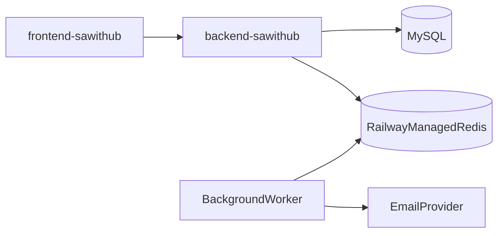

# Architecture

`redis-sawithub` mendokumentasikan cara Redis dipakai oleh service SawitHub dengan MySQL tetap sebagai source of truth.

## High-level Flow

## Redis Domain Usage

- `auth:*` - token revocation, session version, login throttle.
- `ratelimit:*` - distributed rate limiting per user/IP/route.
- `cache:*` - cache read-heavy endpoint.
- `queue:*` - background jobs dan retry queue.
- `presence:*` - state last seen/online pendek.

## Design Principles

- Semua key transient wajib TTL.
- Tidak ada raw PII di Redis values.
- Invalidation event-driven saat write ke MySQL.
- Fallback safe mode saat Redis unavailable:
  - endpoint tetap berjalan dengan degradasi terkontrol.

## Environment Strategy

- Production: Railway Managed Redis.
- Local dev: optional local Redis instance hanya untuk integration test.
